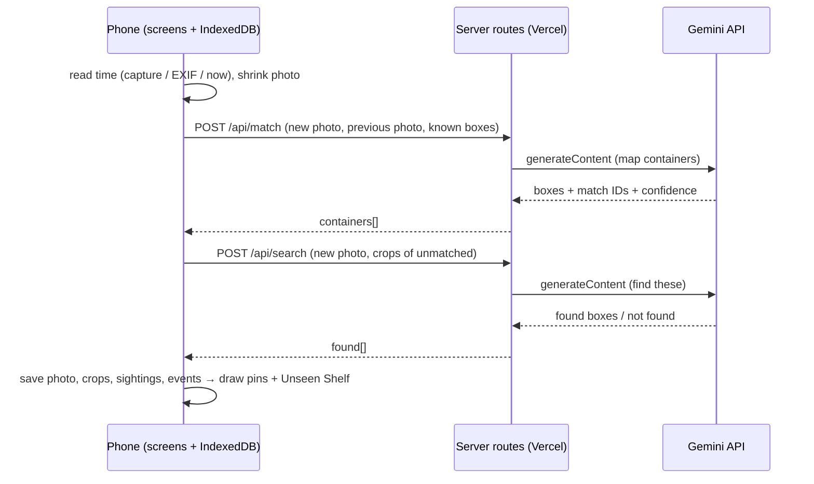

# Leftover Clock — Technical Spec

## How This Works, In Plain Language
Leftover Clock is one Next.js web app with two halves.

- **The phone half (the screens).** Everything you see and tap runs in your phone's browser. Your fridges, photos, containers, and their history live in **IndexedDB**: a small database the browser keeps for this one site, on your phone. Nothing is saved anywhere else, so there's no account. Close the app, come back tomorrow, and it reads the same data back.
- **The server half (two small server routes).** When you add a photo, the phone sends the shrunken photo to the app's own server code on Vercel. That code holds the Gemini key (it never reaches the phone), asks Gemini to match the containers, and sends back boxes and IDs. It saves nothing.

Matching takes two questions to Gemini:
1. **Map it:** "Here are yesterday's photo and its containers, here is today's photo. Which container is which, and which ones are new?"
2. **Search for specific containers:** for every known container step 1 didn't find, "Here is a close-up of this container. Is it somewhere in today's photo?" This step finds the half-hidden, lid-only containers that step 1 missed in both real tests so far.

Whatever is still not found goes to the Unseen Shelf. The phone then cuts a crop of each container out of the photo, saves everything, and draws the pins.

Separately, an **evaluation script** runs the same matching code on your real photo pairs and compares its answers with an answer key you confirmed. It counts correct links, misses, and wrong links separately. That's how we measure the match rate honestly.

Why this shape: one project, one deploy, one external service (Gemini), and no database server. The only thing that needs a server is hiding the key.

## The Core Journey Through the System
PRD ref: `prd.md > The Core Journey`.

1. **Open the app.** The Fridge List page reads `fridges` from IndexedDB and shows a card per fridge, with a timeline button on each card.
2. **Tap a fridge.** The Fridge View reads the fridge's latest photo and its sightings (the boxes on that photo) and draws pins. Active containers with no sighting on that photo appear on the Unseen Shelf.
3. **Add a photo.** "Take photo" opens the phone's own camera (`<input type="file" accept="image/*" capture="environment">`), and the photo's time is the moment it comes back. "Upload" reads the photo's stored timestamp (`DateTimeOriginal`, via exifr); if there is none, it uses the current time. The time is shown and can be edited. The phone then shrinks the photo to about 1200×1600 JPEG. Re-encoding also drops all EXIF, including GPS.
4. **Matching.** The phone shows reminders computed from IndexedDB while it:
   - calls `POST /api/match` with the new photo, the latest previous photo, and the list of containers on it (ID + box);
   - calls `POST /api/search` with the new photo and crops of every active container step 1 didn't match (unmatched ones from the latest photo plus everything on the Unseen Shelf). Skipped if that list is empty;
   - if step 1 fails or finds zero containers, it goes to Photo Check instead and nothing is saved.
5. **Apply the result** (all on the phone, in one IndexedDB transaction). It saves the photo, cuts a crop per box, writes a sighting per container (matched → existing container, unmatched → new container dated to the photo), and writes events (`photo_added`, `added`). Then it goes to the Fridge View, which now shows the new photo.
6. **One-tap fixes.** Tapping a pin opens Container Detail. Each button calls one function in `lib/actions.ts` that changes the container and writes an event in the same transaction, and the pin's age re-renders immediately.
7. **View as list.** Same data, sorted by date ascending (oldest first). Tapping a row opens the same Container Detail.



## Stack
All choices below were agreed with the learner in this conversation. Versions were checked on npm on 2026-10-24; pin them at project setup.

- **Next.js 16 (App Router; 16.4.3 current) + TypeScript**: one project serves the screens and the two server routes. Learner accepted it as a new framework to learn. Tradeoff accepted: the server/client component split takes some getting used to. Screens are client components (`"use client"`) because they read IndexedDB; only `app/api/*` runs on the server. Docs: https://nextjs.org/docs/app · route handlers: https://nextjs.org/docs/app/api-reference/file-conventions/route
- **Dexie 4** (4.4.7) over IndexedDB: phone-side storage for fridges, photos (as Blobs), crops, containers, events. Blobs can be stored but not indexed. Docs: https://dexie.org/docs/API-Reference
- **`@google/genai` 2.x** (2.31.0), server-side only. It uses `models.generateContent`, which is still supported. Google's guide pages now show the newer Interactions API instead, so the build follows the REST reference and the SDK's own types (https://ai.google.dev/api/generate-content, https://github.com/googleapis/js-genai). Docs: https://ai.google.dev/gemini-api/docs · image input: https://ai.google.dev/gemini-api/docs/image-understanding · JSON output: https://ai.google.dev/gemini-api/docs/structured-output
- **exifr 7.1.3**: reads the stored timestamp of uploaded photos in the browser. Tradeoff: there have been no releases since 2021, but it is stable, reads `DateTimeOriginal` from a `File`, and the app only needs that one tag. Docs: https://github.com/MikeKovarik/exifr
- **tsx**: runs the TypeScript evaluation script from the command line. Docs: https://tsx.is/
- **Styling: plain CSS** (`app/globals.css` with design tokens + CSS Modules per component). No UI framework, which keeps dependencies down. Fonts load through `next/font/google`.
- Node 22 (installed: v22.13.1, npm 11.1.0).

## Where It Runs and How Someone Tries It
- **Runtime:** browser (the learner's phone) + Vercel Functions for `/api/match` and `/api/search`.
- **Environment:** `GEMINI_API_KEY`, in `.env.local` locally (already present, gitignored) and as a Vercel project environment variable. Never in the repo or in chat.
- **Local development:** `npm install`, then `npm run dev` and open http://localhost:3000 on the PC. On the phone over the same Wi-Fi (`npm run dev -- -H 0.0.0.0`, then `http://<PC-IP>:3000`) everything works, including "Take photo", because the native-camera file input doesn't need HTTPS.
- **Deployment (learner chose: yes, Vercel Hobby).** `vercel` CLI (logged in) → production URL. Set `GEMINI_API_KEY` in the Vercel project. Each route sets `export const maxDuration = 60`. The Hobby limit with Fluid compute is 300 s (https://vercel.com/docs/functions/limitations). Hosting is free, Hobby is for personal non-commercial use only (https://vercel.com/docs/plans/hobby), and the live URL also gives HTTPS.
- **Keep the data on iPhone:** Safari deletes a site's IndexedDB after 7 days of Safari use without visiting it, but sites added to the Home Screen are exempt (https://webkit.org/blog/10218/full-third-party-cookie-blocking-and-more/). The app ships a minimal web app manifest and calls `navigator.storage.persist()`. The README tells the user to "Add to Home Screen".
- **For the demo recording:** open the production URL on the phone, use the learner's real fridge photos (uploaded from the camera roll with their original dates, or taken live). Record the core loop: Fridge List → Fridge View with pins → add the next day's photo → reminders → pins with ages, the lid-only container found → a one-tap fix → View as list → timelines.
- **Public repository:** https://github.com/JaeHoon-Do/leftover-clock (MIT; created 2026-10-26, commit authors set to the GitHub noreply address before the first push; `devpost/learner-profile.md` and local agent folders kept out).
- **Submission needs** a short demo video and a public GitHub repository; the live URL is extra and doesn't replace either. Data on the live site lives in each visitor's own browser, so a judge trying the URL starts with an empty fridge list and uses their own photos.
- **Evaluation:** `npx tsx eval/run-eval.ts --photos <folder> --pair <truth file>` (reads `GEMINI_API_KEY` from `.env.local`). Prints a counts table and saves the full output to `eval/results/`.

## Look and Feel
Carried from `prd.md > Look and Feel` and `scope.md > Inspiration & Identity`. Two tones, as decided in the PRD.

- **Round and cute (every screen except the Fridge View map):** Cooking Mama spirit. Large corner radii (16–24px), soft drop shadows, chunky pill buttons, friendly fridge illustrations on the cards. Rounded display font **Fredoka** for headings and buttons, **Nunito** for body text. Warm palette tokens: cream background `--bg #FFF8EE`, ink `--ink #3A2E2A`, tomato `--accent #FF6B5B`, mint `--mint #7ED9C3`, butter `--butter #FFD166`.
- **Clean map (Fridge View):** the photo is the focus, edge to edge. Each pin is its age chip: a small butter-yellow rounded sticker with dark Fredoka text ("3d") whose tail points at the box's center, placed so none overlap (see `### Pin Layout`); no dots. The site is light-only (`color-scheme: only light`), so browsers don't auto-darken it. Chrome is minimal: a floating pill bar with "Add photo" and "View as list". The Unseen Shelf below the photo returns to the round, cute tone (a drawn shelf with crop "jars" on it).
- **Copy tone:** short, warm, plain English. Ages are facts ("5 days"), never judgments: no "safe", "fresh", or "eat today" (consistent with `prd.md > Non-Goals`). No "old" highlighting (deferred in `prd.md > Possible Later Enhancements`).
- **Fridge illustrations:** 4 simple SVG fridges (different colors and shapes) drawn in the same rounded style, in `public/fridges/`.

## Components

### Fridge List
Start screen. Reads `fridges`, shows cards (image + name), a timeline button per card, and "Add fridge". If there are no fridges, it shows only an inviting "Add fridge".
PRD ref: `prd.md > Fridges`, `prd.md > States and Boundaries` (No fridges yet), `prd.md > Timelines` (button on the card).

### Add Fridge
Name input, an illustration grid, and a "Use my photo" option (a file input; the image is shrunk to about 600px). Saves a `fridges` row.
PRD ref: `prd.md > Fridges`.

### Fridge View
Shows the latest photo with pins (`PhotoMap`), the Unseen Shelf below, and a pill bar with "Add photo" and "View as list". With no photos yet, it shows an invitation to add the first photo instead.
PRD ref: `prd.md > Matching and Pins`, `prd.md > States and Boundaries` (Fridge with no photos).

#### Pin Layout
`lib/labels.ts`. Pins sit at box centers (box coordinates are 0–1000, scaled to the displayed photo). Tooltips are placed greedily from the top of the photo down: try right, left, above, below; keep the first spot that overlaps no placed tooltip and stays inside the photo; otherwise nudge it outward in small steps, with a thin leader line back to the pin. This is re-run when the displayed size changes. Checked against the real demo photos (about 25 containers).
PRD ref: `prd.md > Matching and Pins` ("Tooltips are laid out so they never overlap").

### Add Photo
Two buttons: "Take photo" (native camera) and "Upload". Shows the photo and a date-time field, pre-filled by capture time, then EXIF `DateTimeOriginal`, then now, and editable. Shows a one-line notice that photos are sent to Google's Gemini API (free tier, which may be used to improve Google products). "Start matching" goes to Matching.
PRD ref: `prd.md > Adding a Photo and Its Date`.

### Matching and Reminders
`lib/matching-client.ts` runs step 1 → step 2 → apply (see `## The Core Journey Through the System`), while `Reminders` shows cards computed by `lib/reminders.ts` from this fridge's data:
- "These are your oldest containers": the 3 oldest active containers with their crops;
- "You refill these often, but it's been a while": containers with ≥2 `refilled` events whose last refill is the longest ago among them;
- first photo / no history: "Registering your containers for the first time…" with a tip ("Photos taken from about the same spot match best").

Reminder cards rotate every few seconds.
PRD ref: `prd.md > Reminders While Matching`, `prd.md > Matching and Pins`.

### Photo Check
Shown when step 1 returns an error after its retry, or zero containers. If Gemini is busy or the daily free quota is used up, it says so ("Gemini is busy right now. Try again in a minute." / "Today's free matching is used up. Try the sample fridge.") instead of the photo checklist. An ID-scanner-style checklist ("Is the photo blurry?", "Is the fridge door fully open?", "Is the light on?") and "Retake" / "Upload another". On the second failure for the same attempt: "We couldn't read this photo. Your fridge stays as it was." Nothing is written to IndexedDB.
PRD ref: `prd.md > Photo Can't Be Read`.

### Matching Server Routes
`app/api/match/route.ts` and `app/api/search/route.ts`, both thin wrappers around `server/gemini.ts` (the eval script uses the same module). Contracts are in `## External Services and Dependencies`.
- **Step 1 prompt** (based on the two real tests): find every food storage container in the new photo (lidded boxes, tubs, pots with lids, unlabeled jars; ignore packaged retail products, produce, eggs, drawers). For each, decide whether it's the same physical container as one of the known ones. **Position is weak evidence; lid color, body shape and material, and size come first. A container can sit where another one used to.** (This targets the wrong link seen in test 2.) Each known ID is matched at most once. Never name the food. With no known containers (first photo), it only detects.
- **Step 2 prompt:** for each target crop, is this exact container visible anywhere in the new photo, even partly hidden or showing only its lid? Return its box or "not found". Boxes already claimed by step 1's matches are listed so they aren't reused.
- **Model and retry:** `gemini-3.6-flash` with `thinkingLevel: "low"`. On 429/503/timeout, wait 2 s and retry once, then give up (busy). No smaller fallback model: on the tuning pair `gemini-3.5-flash-lite` copied the previous boxes and linked 18 of 23 containers wrongly. The model used is returned and stored on the photo.
- **Step 2 guards:** each target carries its previous box; found boxes that are mostly a claimed box, or more than 4× the previous box's area, are dropped.
- **Development record/replay:** in development, each Gemini response is saved under `.cache/gemini/` keyed by a hash of the request, and the same request is answered from the file. Retrying the same photo costs no quota.

PRD ref: `prd.md > Matching and Pins`.

### Sample Fridge
A "Try the sample fridge" card on the Fridge List. Tapping it imports `public/sample/` (photos re-encoded without EXIF and with brand labels blurred, plus the fridge's containers, sightings, and events exported from a real run) as an ordinary fridge. Its Add Photo offers the bundled next-day photo; matching shows the reminders and then applies the saved `/api/match` + `/api/search` result through the same apply step, with no request to `/api/*`. Removing and re-adding it resets it.
PRD ref: `prd.md > Sample Fridge`.

### Container Detail
A bottom sheet over the Fridge View or List View: the latest crop, the age and date, and the 3 most recent events. Buttons:
- **Refilled** → `refill(containerId, photo)`: `dateStart` = the latest photo's `takenAt`, plus a `refilled` event.
- **This is a new container** → `split(sightingId)`: creates a new container dated to this photo, moves this sighting to it, and writes an event on both. If the old container now has no sighting on the latest photo, it shows on the Unseen Shelf.
- **This is the same container as…** → opens the Same-Container Picker.
- "Timeline" link → Container Timeline.

PRD ref: `prd.md > Container Detail and One-Tap Fixes`.

### Same-Container Picker
By default it shows the most recent earlier photo with its pins (excluding the container being fixed); a toggle switches to a grid of crops of all active containers. Picking one calls `merge(fromId, intoId)`: the picked container keeps its `dateStart` and history, the current container's sightings move into it, and the current container is deleted with a `merged` event on the kept one.
PRD ref: `prd.md > Container Detail and One-Tap Fixes`, `prd.md > Open Questions` (which earlier photo: settled here as "most recent earlier photo").

### Unseen Shelf
Active containers with no sighting on the latest photo. Each shows its clearest crop (the largest box among its sightings, as a stand-in for "clearest"), or a default jar illustration if none. Buttons:
- **Still there** → `still_there` event; it gets a "Still there ✓" tag and stays on the shelf and in the list with its date until it's seen in a photo or removed.
- **Removed** → `status = "removed"`, `removed` event; it leaves the shelf and the list.

Untouched shelf items behave like "Still there" without the tag.
PRD ref: `prd.md > Unseen Shelf`, `prd.md > Open Questions` (untouched shelf items).

### List View
Every active container in the fridge (on the photo or on the shelf), sorted by `dateStart` ascending: crop, age, date. Tapping a row opens Container Detail.
PRD ref: `prd.md > View as List`.

### Timelines
`Timeline` component, used by two pages:
- **Container Timeline:** all sightings (crop + photo time) and events for one container, newest first.
- **Fridge Timeline:** `photo_added` entries (photo thumbnail) and every container event for one fridge, opened from the Fridge List card.

PRD ref: `prd.md > Timelines`.

### Evaluation Harness
Implements the learner's learning goal and `scope.md > Later` (decide on showing the match rate after testing).
- `eval/truth/<prev>_<next>.json`: the answer key for one photo pair: the known containers on the previous photo (ID, box) and every container on the next photo with its approximate box and its true identity (a known ID, or `"new"`), plus which known IDs are truly absent. Truth is drafted by running the matcher once, rendering numbered boxes, and having **the learner confirm or correct each one** (as done for `정답지.md`).
- `eval/run-eval.ts`: runs `server/gemini.ts` (step 1 + step 2, exactly as the app does) on each pair, lines up predicted boxes with truth boxes by overlap, and counts separately:
  - **correct link**: a container present in both photos, linked to its true ID;
  - **missed**: present in both, but predicted as new or left unfound (it would land on the Unseen Shelf);
  - **wrong link**: linked to the wrong ID, including a truly new container given an old ID (the worst error: it inherits an old date);
  - also **new correct** and **absent correct**.

  It prints one table per pair plus totals, and saves raw output to `eval/results/<timestamp>.json`.
- **Tuning vs test (learner decision):** 10/22 and 10/23 photos (and the 10/24 photo) are for tuning prompts. The 10/25 and 10/26 photos are held out: they aren't looked at during prompt tuning, and they're measured once after the prompts are frozen. Those test numbers are the ones reported.
- Photos live in `leftover-clock-photos/` inside the project folder but are gitignored, so they never reach the public repo, because they contain GPS and brand labels (learner decision, 2026-10-24: moved in from `D:/VisualStudio/leftover-clock-photos`). `--photos` defaults to that folder. Truth files contain only IDs, boxes, and short descriptions.

## Data Model
All in IndexedDB (Dexie database `leftover-clock`, version 1). Box coordinates are `[ymin, xmin, ymax, xmax]`, normalized 0–1000 (Gemini's native format).

| Table | Fields | Notes |
|---|---|---|
| `fridges` | `id`, `name`, `image: {kind: "illustration", key} \| {kind: "photo", blob}`, `createdAt` | |
| `photos` | `id`, `fridgeId`, `takenAt`, `blob` (shrunk JPEG, no EXIF), `width`, `height`, `model`, `createdAt` | The latest photo = max `takenAt` for the fridge. |
| `containers` | `id`, `fridgeId`, `dateStart`, `status: "active" \| "removed"`, `createdAt` | `dateStart` = when the current food went in (`scope.md > What the Date Means`). Set to the photo's `takenAt` on add, refill, or split. |
| `sightings` | `id`, `containerId`, `photoId`, `box`, `crop` (JPEG blob), `confidence`, `source: "match" \| "search" \| "new" \| "fix"` | One container on one photo. |
| `events` | `id`, `fridgeId`, `containerId?`, `photoId?`, `type`, `at`, `detail?` | `type` ∈ `photo_added`, `added`, `refilled`, `split`, `merged`, `still_there`, `removed`. `at` = the photo's `takenAt` for photo-driven events, now for button taps. |

**Age** = whole calendar days from `dateStart` to today (local time), shown as "today", "1 day", "5 days".

**Where each piece lives / how it updates / what happens on return:** every row lives only on the phone in IndexedDB. Rows are changed only by the apply step after matching and by the actions in `lib/actions.ts`, each in one transaction together with its event. Leaving and coming back re-reads the same rows. Nothing is lost unless the browser's site data is cleared. The server keeps no state between requests.

## File Structure
```
leftover-clock/
├── app/
│   ├── layout.tsx                 # fonts (Fredoka, Nunito), global CSS
│   ├── globals.css                # design tokens for both tones
│   ├── page.tsx                   # Fridge List
│   ├── fridges/
│   │   ├── new/page.tsx           # Add Fridge
│   │   └── [fridgeId]/
│   │       ├── page.tsx           # Fridge View (map + Unseen Shelf) ⇄ List View, Container Detail sheet
│   │       ├── add-photo/page.tsx # Add Photo → Matching (reminders) → Photo Check
│   │       ├── pick/page.tsx      # Same-Container Picker (?from=containerId)
│   │       ├── timeline/page.tsx  # Fridge Timeline
│   │       └── containers/[containerId]/timeline/page.tsx  # Container Timeline
│   └── api/
│       ├── match/route.ts         # step 1: map new photo against previous photo
│       └── search/route.ts        # step 2: look for specific unmatched containers
├── components/
│   ├── FridgeCard.tsx
│   ├── PhotoMap.tsx               # photo + pins + tooltips
│   ├── UnseenShelf.tsx
│   ├── ContainerSheet.tsx         # Container Detail + fix buttons
│   ├── ContainerList.tsx
│   ├── Reminders.tsx
│   ├── PhotoCheck.tsx
│   └── Timeline.tsx
├── lib/                           # phone-side logic
│   ├── db.ts                      # Dexie schema (tables above)
│   ├── actions.ts                 # applyMatch, refill, split, merge, stillThere, remove: each writes its event
│   ├── matching-client.ts         # calls /api/match then /api/search, handles failure → Photo Check
│   ├── photo.ts                   # timestamp (exifr), shrink, crop from box
│   ├── labels.ts                  # non-overlapping tooltip placement
│   ├── reminders.ts
│   ├── age.ts
│   └── boxes.ts                   # box math + step-1/step-2 merge (shared with eval)
├── server/
│   └── gemini.ts                  # prompts, JSON schemas, retry (server-only; shared with eval)
├── eval/
│   ├── run-eval.ts                # match-rate measurement
│   ├── truth/                     # learner-confirmed answer keys per photo pair
│   └── results/                   # raw outputs per run
├── public/
│   ├── fridges/                   # 4 fridge illustrations (SVG)
│   ├── jar.svg                    # default shelf image
│   └── sample/                    # sample fridge: photos (no EXIF, labels blurred) + rows + replayed result
├── devpost/                       # Devpost learning workspace (scope, prd, spec)
├── .env.local                     # GEMINI_API_KEY (gitignored)
├── package.json
├── README.md                      # run, deploy, evaluate
└── LICENSE                        # MIT
```

## External Services and Dependencies

### Gemini API
- **Auth:** API key in `GEMINI_API_KEY`, server-side only (`new GoogleGenAI({ apiKey })`).
- **Call:** `ai.models.generateContent({ model, contents: [{ role: "user", parts: [{ inlineData: { mimeType: "image/jpeg", data: <base64> } }, …, { text: prompt }] }], config: { responseMimeType: "application/json", responseSchema, thinkingConfig: { thinkingLevel: ThinkingLevel.LOW } } })`. (Levels: MINIMAL, LOW, MEDIUM, HIGH. The default is MEDIUM for 3.6 Flash and MINIMAL for 3.5 Flash-Lite.)
- **Models:** `gemini-3.6-flash` (primary, no fallback; see `### Matching Server Routes`). `gemini-3.8-flash` was compared on the tuning pair (2026-10-24): most accurate in its one clean run but 504s/90 s timeouts in all three runs and about 3 minutes per photo, so it isn't used. Both were confirmed available for this key on 2026-10-22 and are marked Stable on the models page (2026-10-24). Google now calls 3.6 Flash "previous-generation"; `gemini-3.8-flash` is newer (see Decisions). 3.6 Flash returned 503 "high demand" once, then 200 on retry.
- **Measured cost:** about 5,000–5,500 tokens and 6–10 s per mapping call (two real tests). Free tier, no billing linked: **20 requests per day per model** for `gemini-3.6-flash` (`GenerateRequestsPerDayPerProjectPerModel-FreeTier`, measured 2026-10-24; resets at midnight Pacific), i.e. about 10 photos a day across tuning, testing, the demo, and judges. Quota exhaustion shows Photo Check's quota message, and the sample fridge works without any calls. Free-tier inputs may be used to improve Google products, which is disclosed on Add Photo and in the README.
- **Limits:** a whole request must stay under 20 MB of inline data. Our requests are about 1.5 MB.
- Docs: https://ai.google.dev/gemini-api/docs · models: https://ai.google.dev/gemini-api/docs/models · thinking: https://ai.google.dev/gemini-api/docs/thinking · pricing (free tier "Used to improve our products: Yes"): https://ai.google.dev/gemini-api/docs/pricing

### `POST /api/match` (our route)
```jsonc
// request
{ "newPhoto": "<base64 jpeg>", "prevPhoto": "<base64 jpeg> | null",
  "known": [{ "id": "c3", "box": [379,336,423,458], "desc": "clear tub, pink lid" }] }
// response 200
{ "model": "gemini-3.6-flash",
  "containers": [{ "box": [..], "match": "c3" | null, "confidence": 0.93, "desc": "clear tub, pink lid" }] }
// response 502
{ "error": "unreadable" | "busy" }
```

### `POST /api/search` (our route)
```jsonc
// request
{ "newPhoto": "<base64 jpeg>", "claimed": [[..box..]],
  "targets": [{ "id": "c20", "crop": "<base64 jpeg>", "box": [..previous box..] }] }
// response 200
{ "model": "...", "found": [{ "id": "c20", "box": [..], "confidence": 0.8 }], "notFound": ["c18"] }
```
A found box that overlaps a step-1 `match: null` box by more than half replaces that "new" container instead of adding a second one.

### Vercel (Hobby)
Hosting plus the two functions. Request and response body limit 4.5 MB (413 `FUNCTION_PAYLOAD_TOO_LARGE` beyond): one photo (~300 KB) + previous photo + up to ~30 crops (~20 KB each), base64, is about 1.5 MB. Docs: https://vercel.com/docs/functions

## Important Failure Modes
- **Gemini busy (503/429) or slow** → one retry after 2 s. If it still fails: Photo Check with "busy, try again". Existing data is untouched.
- **Daily free quota used up (429, per-day quota)** → Photo Check says so and points to the sample fridge. Existing data is untouched.
- **Zero containers found / unreadable photo** → Photo Check, retake or upload another. On the second failure, a plain message and nothing changes.
- **Wrong link (a new container inherits an old date)** → the prompt rule "position is weak evidence", measured by the eval harness as "wrong link". In the app, "This is a new container" fixes it in one tap.
- **Crowded tooltips** → the greedy layout with leader lines; "View as list" stays one tap away.
- **Uploaded photo loses its timestamp** → current time is pre-filled and editable. Evidence on iOS is mixed: since iOS 16.4, photo-library picks reportedly keep dates and drop location, while one report says camera captures lose metadata (https://bugs.webkit.org/show_bug.cgi?id=207088, medium/low confidence). Captures use the capture time anyway. Checked early on the learner's iPhone.
- **iPhone clears the data** after 7 days without visiting the site in Safari → Home Screen install + `navigator.storage.persist()` (see `## Where It Runs and How Someone Tries It`).

## What Was Simplified and Why
- **Phone-only storage (IndexedDB)** instead of a server database: one user, one phone (`scope.md > Explicitly Cut`). A server database would need hosting, an account, and sync.
- **Native camera via file input** instead of a live in-app camera view: simpler, best photo quality, and works without HTTPS during local development.
- **"Clearest crop" = largest box** instead of a sharpness score: good enough to pick a readable crop. A real score would need image analysis per crop.
- **Matching runs only when a photo is added** (no background jobs): matches the core loop.
- **Photos are matched against the fridge's latest photo**: photos are expected to be added in time order (as in daily use and the demo). Adding an older photo after a newer one still matches against the latest; reordering history would need re-matching later photos.
- **No match-confidence review queue**: the PRD applies results automatically and fixes take one tap. Confidence is still stored for the eval and for later.
- **Pairwise evaluation on a few real photo pairs** instead of a large benchmark: the honest number is "on held-out photos of a real fridge". No public, permissively licensed multi-day fridge photo set exists (searched 2026-10-24, see Decisions).

## Decisions and Open Issues

### Learner decisions (this conversation)
- **Open to a new stack; accepted Next.js + TypeScript + IndexedDB (Dexie) + Gemini** on the agent's recommendation. Tradeoff accepted: learning the Next.js server/client split.
- **Runs on the learner's phone and is recorded; deployed to Vercel**, which also provides HTTPS.
- **A web app, not a native APK** (confirmed in review): a link opens on iPhone, Android, and desktop, while an APK can't be installed on iPhone and is awkward for judges.
- **Two-step matching** (map, then search for specific unmatched containers). Tradeoff accepted: waiting time may grow from about 10 s to about 20 s, filled by reminders.
- **Honest match rate:** tuning photos 10/22–10/23 (plus 10/24); test photos 10/25–10/26 held out and measured once after prompts are frozen; correct / missed / wrong link counted separately.
- **Also test on a public multi-day fridge dataset if a permissively licensed one exists** (e.g. MIT). Searched 2026-10-24 across Roboflow Universe, Kaggle, Hugging Face, and arXiv, with this result:
  - **Not found:** no public set photographs one fridge over several days with the same leftover containers coming back.
  - **Closest substitutes:**
    - **AICook** (Roboflow Universe, listed as MIT, page not directly verified): 516 staged photos of one fridge with groceries rearranged, no dates, no opaque tubs. Identity labels would have to be added. https://universe.roboflow.com/objectdetectionlearning-4empo/aicook-lcv4d-zzbgs
    - **HD-EPIC** (CC BY 4.0): multi-day head-camera video of 9 kitchens. Fridge frames would have to be cut out and labeled. 2.3 TiB. https://data.bris.ac.uk/data/dataset/3cqb5b81wk2dc2379fx1mrxh47
    - **CORe50** (CC BY 4.0, some listings say CC BY-SA): same household objects across sessions, not fridges.
    - **EPIC-KITCHENS:** non-commercial only, so it's unusable for a public repo.
  - **Learner decision (review): don't add an outside dataset to the POC.** This follows the agent's recommendation: the nearest options don't contain the opaque-tub case, and labeling would take hours before 10/27. The reported number comes from the held-out real-fridge pairs.

### Implementation details derived from those decisions (agent)
- Plain CSS with tokens, Fredoka/Nunito, the palette above. Can be changed in review.
- Container Detail as a bottom sheet; the picker defaults to the most recent earlier photo; "Still there" keeps the item on the shelf with a tag.
- One retry, no fallback model; step-2 boxes replace overlapping step-1 "new" boxes.
- Sample fridge stored as static files and replayed through the same apply step (learner decision: stay on the free tier, 2026-10-24).
- The evaluation code calls the same `server/gemini.ts` as the app, so what's measured is what ships.
- Matching code is written fresh in this repo. The preflight scripts in `leftover-clock-photos/runs/` are reference only and aren't copied (new-project rule).

### The learner's useful unknown
How to measure a vision model's container matching **honestly**. Clarified in conversation: tuning prompts on the same photos used for scoring inflates the score, so the test photos are held out. A single combined score hides the worst error (a wrong link gives a new container an old date), so the three outcomes are counted separately. Evidence comes from the evaluation harness on the 10/25–10/26 pairs.

### Verify early in the build
- Versions and Vercel limits were confirmed on 2026-10-24 (above). Re-check only if setup shows a different major version.
- **Model choice (learner accepted in review):** run the evaluation harness on the tuning pairs with `gemini-3.6-flash` (measured so far) and `gemini-3.8-flash` (newer), and keep the better one as primary *before* the test photos are measured.
- Whether the learner's iPhone keeps `DateTimeOriginal` on photos picked via the file input.
- Tooltip layout on the real demo photo with about 25 containers.

### Open
- Carried from `prd.md > Open Questions`: both are settled above (picker photo = most recent earlier photo; untouched shelf items = like "Still there").
